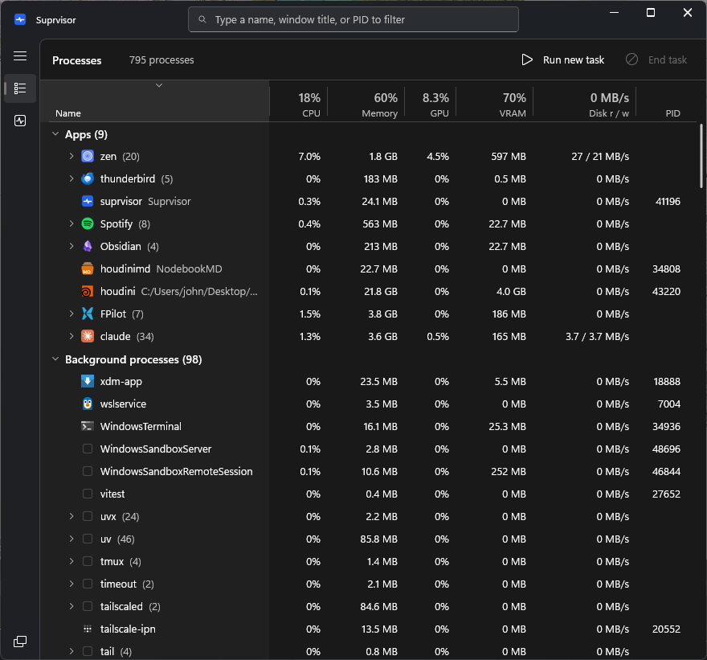

# Suprvisor



**<p align="center">A fast replacement for the Windows 11 Task Manager, written in Rust.</p>**

The stock Task Manager lags at launch, freezes for over a second when you sort a column,
and draws broken rows while it loads. \
It also hides per-process VRAM use.

Suprvisor opens on Ctrl+Shift+Esc in one frame and shows CPU, RAM, GPU
and VRAM per process.

## Install

```powershell
powershell -ExecutionPolicy Bypass -File install.ps1
```

Builds, copies to `C:\Program Files\Suprvisor`, registers two elevated tasks and redirects
`taskmgr.exe` to Suprvisor (IFEO). One UAC click. While Suprvisor runs, Ctrl+Shift+Esc goes to
its keyboard hook. When it does not run, the redirect starts it elevated. `uninstall.ps1` returns
Windows to stock.

## Use

The window follows Task Manager: search box in the title bar, navigation pane on the left.
The X, Ctrl+W and Esc (with an empty filter) hide Suprvisor to the tray. Exit is in the tray menu.
Suprvisor starts hidden at logon.
"Windows Task Manager" in the navigation pane opens the real one.

- Type anywhere or Ctrl+F to filter. The search box has the keys of a Windows edit control.
  Down moves to the rows.
- Click a header to sort. Drag a header to reorder; drag a separator to resize, double-click it
  to fit. Right-click a header to show or hide columns.
- Click, Shift+click, Ctrl+click or drag to select rows. Del or End task ends all of them.
- Tab moves between the search box, the navigation pane, the commands, the headers and the rows.
  Shift+F10 or the menu key opens the context menu.
- Ctrl+N or "Run new task" starts a process. Ctrl+1/Ctrl+2 or Ctrl+Tab switch pages.
- Performance shows 60 s graphs of CPU, each core, memory, GPU, VRAM, disk and network.